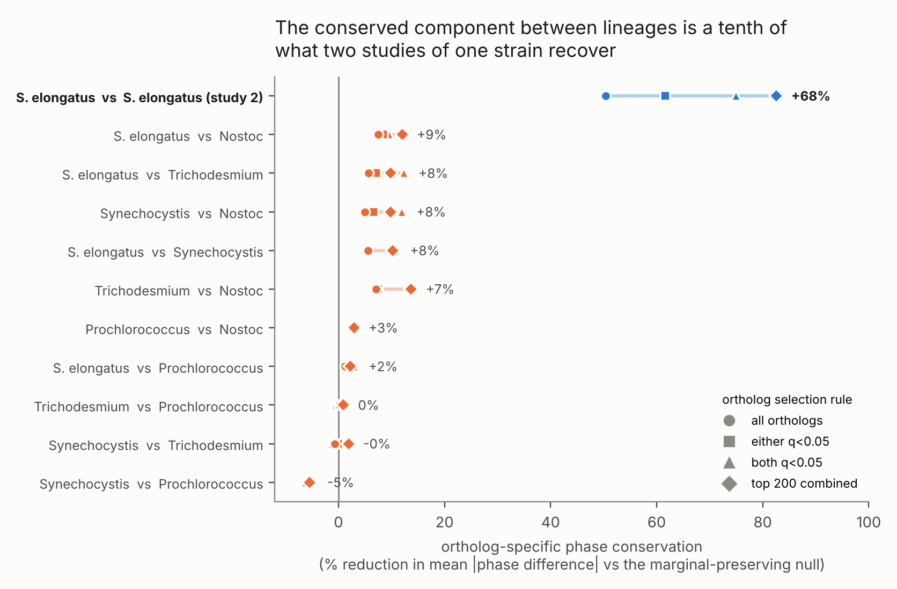
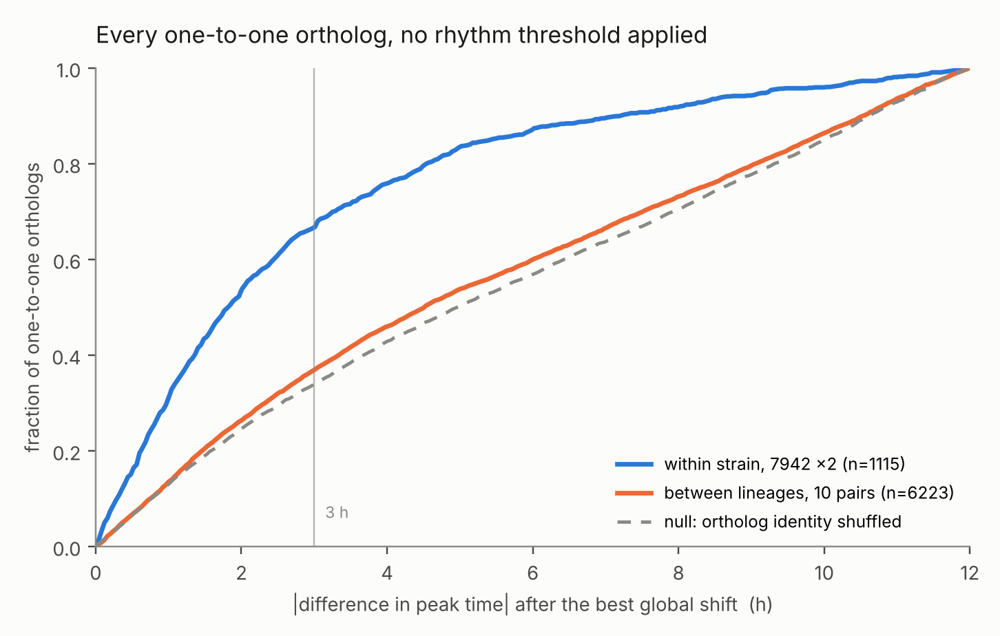
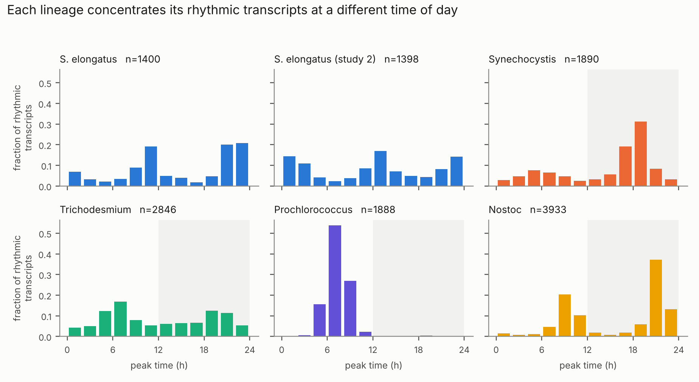

# Is the cyanobacterial circadian *transcriptional program* conserved across lineages?

**A reanalysis of eight public diel/circadian transcriptome time courses from six cyanobacterial
lineages, measured against the reproducibility ceiling set by two independent studies of one strain.**

> **Revision note (18 Nov 2026).** The first pass of this analysis concluded that cross-lineage
> conservation was "at chance". That was wrong — an underpowered binary statistic on too few
> orthologs. With one-to-one orthologs, a continuous statistic and 3–5× more genes per comparison,
> a weak but statistically real conserved component appears. The conclusion below is the corrected
> one. The error and its cause are documented in *What the first pass got wrong*.

---

## 1. The claim being tested

The Kai oscillator is described as the universal prokaryotic clock, and its transcriptional output
as a global clock-controlled program. The genomic half of that is well supported — KaiB/KaiC
homologues are distributed far beyond cyanobacteria (Schmelling et al. 2017). The transcriptional
half is an extrapolation: the genome-wide program was mapped in *Synechococcus elongatus* PCC 7942,
and conservation of **which genes cycle, and when** has not been measured across cyanobacterial
lineages.

A conservation measurement is meaningless without a scale. Two independent 2009 studies profiled the
free-running transcriptome of the same strain on different platforms, in different labs. That pair
sets the ceiling: it is what "the same program, measured twice" looks like.

## 2. Prior art — read `PRIOR-ART.md` before citing any of this as new

The comparative design is **not** novel. **Ferrari et al., *Nat Commun* 10:737 (2019)** ran
essentially this analysis across nine Archaeplastida — one-to-one orthologs, mean |Δphase|, a global
phase shift, a permutation null — *including *Synechocystis* PCC 6803 as an outgroup* — and
concluded the opposite: "evidence for the universality of diurnal gene expression". **Brooks et al.,
*J Biol Rhythms* 38:556 (2023)** showed in 57 mouse-liver studies that rhythmic gene-set membership
replicates poorly between studies while core-clock phase does not — the mammalian analogue of §6.1
here, plus the warning that produced the correction above.

What appears to be new here: the within-cyanobacteria comparison; using within-strain cross-study
reproducibility as the yardstick; an explicit marginal-preserving null; and the quantitative answer —
the cross-lineage conserved component is **roughly a tenth** of the within-strain effect.

## 3. Headline result

**Ortholog-specific peak timing is strongly reproducible within a strain and weakly conserved between
lineages — the conserved component is real but an order of magnitude smaller.**

Effect size = % reduction in mean |phase difference| between orthologs relative to a null that
preserves each dataset's own phase distribution and shuffles only which ortholog carries which phase.
Each pair is scored at its best global time-origin shift, and the null is optimised identically.

| ortholog selection | within strain (7942 ×2) | between lineages (10 pairs), median | max |
|---|---|---|---|
| **all one-to-one orthologs, no rhythm threshold** | **50.4%** | **4.0%** | 7.5% |
| either dataset q<0.05 | 61.6% | 4.2% | 8.4% |
| both datasets q<0.05 | 75.0% | 5.0% | 12.3% |
| top 200 by combined rank | 82.6% | 6.4% | 13.7% |



In absolute terms: mean |Δphase| is **1.38 h** between the two studies of one strain against a null
of 5.54 h, and **3.80–5.36 h** between lineages against nulls of 3.92–5.70 h.



## 4. The panel

| dataset | lineage | GEO | condition | platform | samples | timepoints | rhythmic (q<0.05) |
|---|---|---|---|---|---|---|---|
| SE7942_ito_WT | *S. elongatus* PCC 7942 | GSE14225 | **LL** (free-running) | array | 24 | 13 | 56.2% |
| SE7942_ito_KAINULL | *S. elongatus* **kaiABC-null** | GSE14225 | LL | array | 22 | 11 | **0.0%** |
| SE7942_vijayan | *S. elongatus* PCC 7942 | GSE18902 | **LL** | array (other platform) | 16 | 16 | 52.5% |
| SYN6803 | *Synechocystis* sp. PCC 6803 | GSE79714 | LD 12:12 | array | 24 | 24 | 68.0% |
| TERY | *Trichodesmium erythraeum* IMS101 | GSE99896 | LD | array | 27 | 9 | 59.7% |
| MED4 | *Prochlorococcus marinus* MED4 | GSE314951 | LD | RNA-seq | 36 | 12 | 98.3% |
| NPUN | *Nostoc punctiforme* PCC 73102 | GSE275682 | LD | RNA-seq | 30 | 10 | 56.5% |
| HALO_05 / HALO_25 | *Halothece* sp. PCC 7418 | GSE205640 | **LL** | RNA-seq | 12 + 12 | 6 | 0.8% / 4.0% |

Six lineages, four platforms, 2009–2025. Sampling time is recovered from GEO sample titles and
characteristics in every case.

### The rhythm caller is validated, not assumed

* **Negative control.** The *kaiABC*-null arm of GSE14225 — same strain, platform and timepoints, no
  clock — yields **0 of 2490 genes** at q < 0.05.
* **Positive control.** Wild-type *kaiBC*: 3.07 log₂ peak-to-trough, peak at 11.3 h, q = 1.3×10⁻⁹ —
  the textbook dusk-peaking rhythm — and 13.0/13.3 h in the independent study. *Trichodesmium kaiBC*
  peaks at 12.9/13.8 h. *kaiA* is absent from the *Prochlorococcus* data, as it should be.

Full table: `results/clock_gene_control.csv`.

## 5. Method

Per-gene cosinor fit, `y = Σ series intercepts + A·cos(2πt/T) + B·sin(2πt/T)`, with per-replicate and
per-platform intercepts so a gene is called on the shape of its time course rather than a batch
offset; F-test of the harmonic terms, Benjamini–Hochberg corrected; phase = fitted peak.

Three choices do the real work:

1. **One-to-one orthologs.** Primary analysis: KEGG KOs that are single-copy in each genome's
   annotation and unique in each dataset. Robustness: Smith–Waterman **reciprocal best hits**
   computed directly between proteomes (`src/rbh.py`), which does not depend on KEGG's coverage.
   Original locus tags are bridged to current RefSeq proteins through the GFF `old_locus_tag`.
2. **A marginal-preserving null.** Transcripts do not peak uniformly around the clock; each dataset
   piles them into a few hours (§6.4). A null that shuffles ortholog identity while keeping each
   dataset's phase distribution isolates the ortholog-specific component. Ferrari et al.'s null
   permutes time points instead, which expects near-uniform phases — see `PRIOR-ART.md`.
3. **Offset invariance.** Studies set their time origin differently, so each pair is scored at its
   best global shift (−12…+12 h), with the null optimised the same way. The method recovers a −1 h
   offset between the two 7942 studies, matching their 1.38 h mean phase difference.

## 6. Results

### 6.1 Within the model strain: phase replicates, set membership does not

Over 2490 shared genes between the two independent 7942 LL studies:

| | |
|---|---|
| rhythmic, study 1 / study 2 | 1400 / 1324 |
| rhythmic in both | 966 (expected if independent: 744) |
| Jaccard of rhythmic sets | 0.549 |
| replication rate of study 1's calls | 0.690 |
| median \|phase difference\| | **1.67 h** |
| phase agreement within 4 h | **93.8%** |

Membership reproduces only 1.30× better than chance at a fixed threshold — the pattern Brooks et al.
report for mouse liver — while phase replicates tightly. Phase is therefore the quantity worth
comparing across lineages. On a rank-based measure, co-rhythmicity is 5.29× independence (top 10%).

### 6.2 Between lineages: weak, real, and inconsistent

With both datasets thresholded at q<0.05 and the marginal-preserving null, 7 of 10 cross-lineage
pairs are significant (p<0.05), with effect sizes of 2.9–12.3%; three pairs sit at or below zero
(*Synechocystis*×*Prochlorococcus* −6.2%, *Synechocystis*×*Trichodesmium* −1.2%,
*Trichodesmium*×*Prochlorococcus* −0.5%). The within-strain pair is 75.0% in the same units.

So the conserved component exists and is detectable — with ~150–500 orthologs and a continuous
statistic — but it recovers at most an eighth of what measuring the same strain twice recovers.

### 6.3 The gap is not a thresholding artifact

Brooks et al.'s warning is that thresholding each study separately manufactures non-replication. The
table in §3 answers it: with **no rhythm threshold at all**, over every one-to-one ortholog, the
within-strain effect is 50.4% and the cross-lineage median is 4.0%. The gap narrows as thresholds
relax but never closes; it ranges 8–13× across the four selection rules.
(`results/n2_threshold_sensitivity.csv`)

### 6.4 Each lineage has its own rush hour



*Prochlorococcus* puts **91%** of rhythmic transcripts into one 6 h window; *Halothece* at high salt
87.5%; *Synechocystis* 59% into ZT15–21; *Nostoc* 56.5% into ZT18–24; the two 7942 studies are most
spread (32–46%). The windows do not coincide. This is the structure that makes naive cross-lineage
comparisons look conserved, and it is a result in itself: the *temporal architecture* of the
transcriptome is lineage-specific.

### 6.5 Both nulls, side by side — and what a uniform-expectation null does

Running Ferrari et al.'s time-permutation null and the marginal-preserving null on the same
cyanobacterial data (`results/n1_two_nulls.csv`) calls 5 of 10 and 7 of 10 cross-lineage pairs
significant respectively. **The null choice does not flip the verdict on this data**, and it is not
what separates within-strain from cross-lineage. Effect size is.

But the choice matters in general, and the failure mode is quantifiable. In a simulation where the
truth is fixed at **zero** ortholog-specific conservation — each species' phases drawn independently
from its own piled-up marginal distribution — every rejection is a false positive by construction
(`src/null_simulation.py`, `results/n4_null_simulation.csv`, 120 trials per cell):

| fraction of genes peaking in one 6 h window | uniform-expectation null, n=300 | n=1500 | marginal-preserving null, n=300 | n=1500 |
|---|---|---|---|---|
| 0 (phases uniform) | 0.083 | 0.025 | 0.050 | 0.017 |
| 0.4 | **0.833** | **1.000** | 0.025 | 0.050 |
| 0.6 | **1.000** | **1.000** | 0.058 | 0.042 |
| 0.9 | **1.000** | **1.000** | 0.075 | 0.058 |

The marginal-preserving null holds its nominal 5% in every cell. The uniform-expectation null is
correct only when phases really are uniform, and fails completely under any realistic pile-up — and
it gets *worse* with more orthologs, because the extra power goes into detecting the shared marginal
rather than shared ortholog timing. At n=1500, the size of the reciprocal-best-hit sets used in §9,
it is wrong 100% of the time from 40% pile-up upward. For calibration, the busiest-6 h fraction in the datasets analysed
here runs from 0.32 (*S. elongatus*, study 2) to 0.91 (*Prochlorococcus*) — every one of them at or
above the regime where the uniform null fails at least 83% of the time.

**What this does and does not establish.** Ferrari et al.'s null is a time-point permutation re-run
through JTK, which approaches uniformity but need not reach it — in the emulation here it produced
nulls with mean |Δphase| of 4.4–5.7 h rather than the 6.0 h of a uniform distribution. So this does
not prove their specific null inherits the full failure rate; that needs their data. It does show
that the pattern they report — most species pairs becoming "significantly similar" once a global
shift is allowed — is exactly what this failure mode produces, and that the burden of proof now
sits with the uniform-style null.

### 6.6 The weak conserved component has no identifiable gene set behind it

If a conserved core exists, it should be visible as orthologs whose phase agrees across lineages
once each lineage's arbitrary time origin is removed. Aligning every lineage to PCC 7942 by the
single global shift that minimises mean |phase difference| (Synechocystis −2 h, Trichodesmium −9 h,
Prochlorococcus −10 h, Nostoc −11 h) and measuring each ortholog's phase dispersion across lineages
gives an attractive-looking answer: the tightest 33 orthologs cluster at ~20–23 h in aligned time
with phase SDs of 0.1–2.4 h, and they are biosynthetic — *fabI*, *fabZ*, *dxr*, *ispH*, *metK*,
*ahcY*, *sat*, *glgC*, *pdhB*, *yidC* — which reads as a pre-dawn anabolic preparation module.

**The control does not support it.** The alignment is chosen to make the lineages' phase modes
coincide, so orthologs near that shared mode get a low SD whether or not their timing is
ortholog-specific. Shuffling ortholog identity within each lineage — preserving the aligned phase
distributions and the alignment itself — produces 41.9 orthologs below the same SD cutoff against
48 observed (p = 0.13, 1.14×). Pathway enrichment is correspondingly weak: only the generic
"biosynthesis of secondary metabolites" map reaches q < 0.05.

So the 5–12% aggregate effect is real at the pair level, with 1000–1700 orthologs behind each
estimate, but it is **distributed rather than attributable to an identifiable conserved gene set**
at this power. (`results/n5_conserved_core.csv`, `n5_core_sd_null.csv`,
`n5_core_pathway_enrichment.csv`)

### 6.7 No detectable decay with divergence

Effect size vs whole-genome KO-complement similarity: Spearman ρ = 0.27, p = 0.34 (n = 14 pairs).
The strongest cross-lineage signals do involve the closest relatives, but not significantly.

### 6.8 The evidence base is thinner than it looks

Of six lineages, only two have genome-wide free-running data — 7942 and *Halothece* — and the
*Halothece* series is 6 timepoints over 30 h per condition, yielding 0.8–4.0% rhythmic genes with the
best-fit period pinned at the 28 h edge of the scan. **Effectively one cyanobacterial lineage has
adequate free-running transcriptome data.** Everywhere else, "the circadian program" is read off
light/dark courses that cannot separate clock output from the direct light response.

## 7. What the first pass got wrong

The initial analysis required an ortholog to clear a rank threshold in **both** datasets and scored
agreement as "fraction within 3 h". On the KO sets available that left 17–175 orthologs per pair,
and the statistic discards magnitude information. It returned a cross-lineage median enrichment of
1.04× and the conclusion "at chance". Moving to single-copy one-to-one orthologs (146–488 per pair)
and a continuous mean-|Δphase| statistic reveals a consistent, significant 3–12% effect in most
pairs. **The direction of the conclusion — a large within-strain effect and a much smaller
cross-lineage one — survived; the claim that cross-lineage conservation was absent did not.**

Brooks et al. (2023) predicted exactly this failure mode in print. It should have been found before
the first write-up, not after.

## 8. Limitations

1. **LD vs LL.** 7942 is free-running; four of five test lineages are light/dark driven. Pairs
   spanning the two measure partly different things. The shared external driver in the LD-only subset
   should *inflate* apparent conservation; those pairs still sit at −6.2% to +11.9%.
2. **Orthology.** Primary analysis uses single-copy KEGG KOs; reciprocal best hits are the
   robustness check (§9). Neither is a phylogenetically validated orthology assignment.
3. **Power.** 146–488 orthologs per pair. A 3% effect is near the resolution of this design.
4. **Heterogeneity.** Sampling 2–6 h, duration 24–60 h, differing platforms and replicate structures.
5. **Phase precision.** *Nostoc* is sampled every 6 h, bounding phase precision at about ±3 h.
6. **No phylogenetic correction.** Pairs are not independent; the 10 cross-lineage comparisons share
   5 genomes.
7. **KEGG coverage is uneven.** Only 870 of 2780 measured *Synechocystis* genes carry a KO that
   matches the array's locus-tag annotation (KEGG lists 1614 sll/slr-style KO-annotated genes, and
   several hundred array probes name a gene symbol rather than a locus tag, so they are dropped).
   This is why the reciprocal-best-hit check matters: it bypasses KEGG entirely and gives 1804
   orthologs for the same pair, with the same answer (§9).
8. **Prior-art search was one pass** (PubMed + one extended web search); the citing literature of
   Ferrari et al. 2019 has not been screened.

## 9. The result does not depend on KEGG: reciprocal best hits agree

Smith–Waterman reciprocal best hits computed directly between proteomes give 1175–1804 one-to-one
orthologs per pair — 3–8× more than single-copy KOs — and reproduce the same numbers
(`results/n3_rbh_orthologs.csv`):

| pair | RBH orthologs | effect, all orthologs | effect, both q<0.05 | KO-based, both q<0.05 |
|---|---|---|---|---|
| **within strain, 7942 ×2** | 2490 (identity) | **50.0%** | **75.4%** | 75.0% |
| *S. elongatus* × *Synechocystis* | 1804 | 6.2% (p<0.001) | 10.9% | 10.7% |
| *S. elongatus* × *Trichodesmium* | 1727 | 5.9% (p<0.001) | 12.3% | 12.3% |
| *S. elongatus* × *Prochlorococcus* | 1206 | 0.6% (p=0.20) | 1.3% (p=0.12) | 2.9% |
| *Trichodesmium* × *Prochlorococcus* | 1175 | 0.7% (p=0.17) | 0.4% (p=0.31) | −0.5% |

The agreement between two independent orthology methods is close to exact. Orthology assignment is
not what drives the result. The *Nostoc* proteome (6900 proteins) dominates runtime and is excluded
from the default subset.

## 10. Next steps, in order of value

1. Screen the papers citing Ferrari et al. 2019 for an existing cyanobacterial version.
2. Apply the marginal-preserving null to the Archaeplastida data itself (ArrayExpress E-MTAB-7188,
   plus Supplementary Data 2–11 of Ferrari et al. for the TPM matrices) — given §6.5, whether
   "universality" survives it is now the most interesting open question in this line.
3. Add lineages: *Cyanothece* ATCC 51142, UCYN-A, *Anabaena* PCC 7120, *Microcoleus*, and the field
   metatranscriptomes (Station ALOHA SRP041215, HOE-Legacy PRJNA358725).
4. Complete the RBH matrix and report KO- and RBH-based results side by side.
5. Test whether the residual 3–12% tracks phylogeny on a larger panel with a proper tree.

## 11. Reproducing

```bash
pip install numpy pandas scipy matplotlib biopython pyswrd
python3 src/fetch_data.py            # all inputs, public, no credentials
python3 src/run_rhythms.py           # rhythm calls -> results/rhythms_per_gene.csv.gz
python3 src/analyze.py               # within-species reproducibility, KO conservation, phase
python3 src/robustness.py            # rank sweeps, permutation tests, phase marginals
python3 src/null_comparison.py       # the two nulls, one-to-one KO orthologs
python3 src/threshold_sensitivity.py # effect size vs ortholog selection rule
python3 src/rbh.py --subset          # reciprocal best hits (slow)
python3 src/rbh_check.py             # the comparison on RBH orthologs
python3 src/figures.py               # figures/
```

Runs on a laptop; no GPU. `src/datasets.py` records what was pulled and how sampling time was
recovered.
